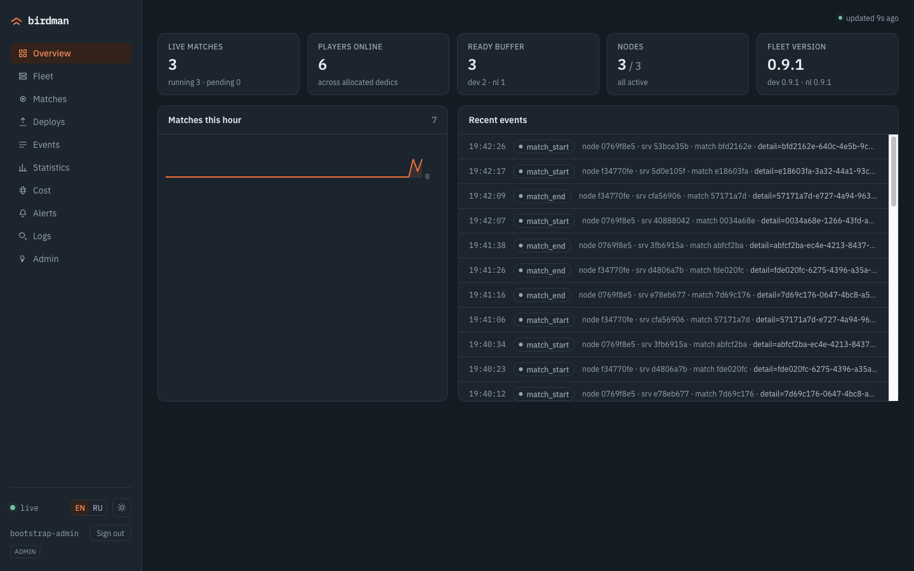
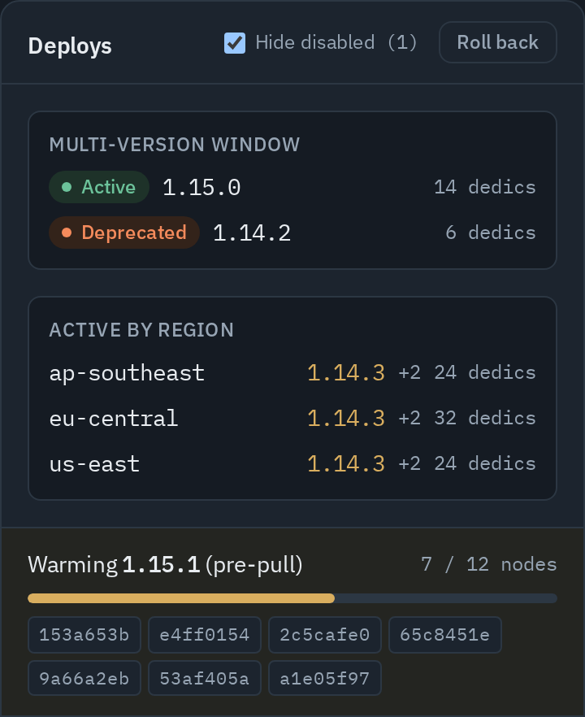
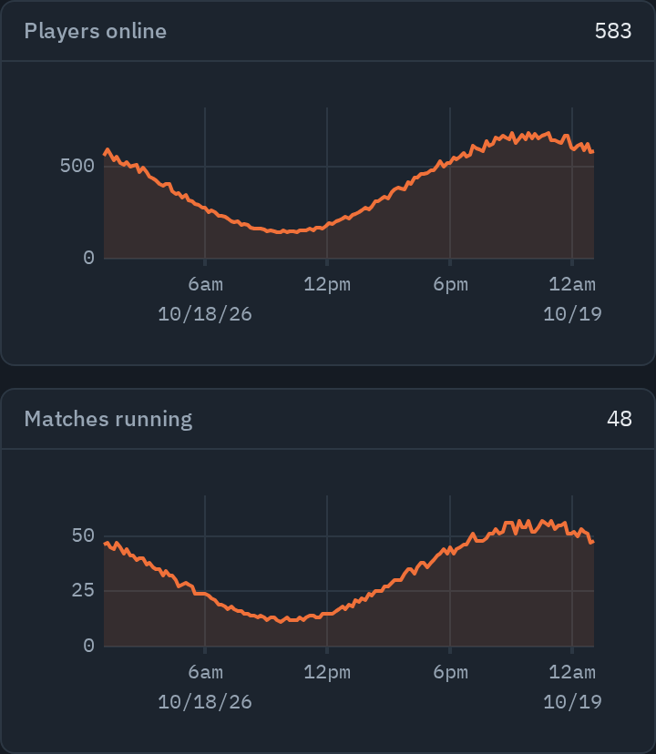

<h1 align="center">
   birdman
</h1>

<p align="center">
  <strong>Your servers. Your matches. Your fleet.</strong><br />
  Dedicated game-server hosting without Kubernetes.<br />
  Matchmaking, warm pool, deploys and observability on your own Linux machines.
</p>

<p align="center">
  <a href="#quick-start">Quick start</a> &nbsp; | &nbsp;
  <a href="#features">Features</a> &nbsp; | &nbsp;
  <a href="#ai-agents">AI agents</a> &nbsp; | &nbsp;
  <a href="#documentation">Documentation</a><br />
  <sub>Linux &nbsp; | &nbsp; Session-based games &nbsp; | &nbsp; English and Russian panel &nbsp; | &nbsp; MIT</sub>
</p>

<p align="center">
  <kbd> Go</kbd> &nbsp;
  <kbd> containerd</kbd> &nbsp;
  <kbd> PostgreSQL</kbd>
</p>

birdman runs your own fleet of dedicated game servers for **short-lived matches**.
A **master** handles matchmaking, fleet control, the REST API and the admin panel.
A **node agent** on each game machine runs servers as containerd containers, and a
small **C++ SDK** links into your game server. Linux-only, built for our own games
and open-sourced under MIT.

<p align="center">
  <a href="docs/images/panel-overview.png"></a><br />
  <sub>Panel screenshots use the built-in demo dataset (<code>npm run dev:demo</code> in <code>panel/</code>), not a production fleet.</sub>
</p>

## Features

**A match ready in milliseconds.** Dedicated servers wait in a warm buffer, so
a match gets a `host:port` without a cold container start. The matchmaker places
tickets by region and by measured round-trip time to the fleet.

### Two versions live at once

Pre-pull a new build, then switch the fleet while existing matches keep running.
Previous versions drain as their matches end; a rollback is the same move in
reverse.

<p align="center">
  <a href="docs/images/panel-deploys.png"></a>
</p>

### What the fleet is doing

Follow players, matches, queue depth and slot utilization over time, with logs
and alerts in the same panel. VictoriaMetrics and VictoriaLogs stay behind the
master's public API, and log history outlives the servers that wrote it.

<p align="center">
  <a href="docs/images/panel-stats.png"></a>
</p>

- **Many games and environments, one install.** Nodes, versions, matches, events,
  metrics and logs belong to a `(project, env)` pair. Every screen narrows to the
  selected scope, and a key bound to a pair reaches nothing outside it.
- **mTLS and encrypted secrets.** Nodes enroll against a built-in CA and dial the
  master over mTLS gRPC. Registry tokens and the CA key are sealed with AES-256-GCM.
- **Postgres backups with an offsite copy.** Scheduled dumps, local retention and
  an optional S3 target. Manage schedules, history and run-now from the panel;
  a stale backup raises an alert.
- **Optional WireGuard overlay.** Keep master-to-node control traffic off the
  public internet.
- **English and Russian panel.** Fleet, matches, deploys, statistics, cost and
  alerts, with light and dark themes. The panel ships inside the master binary.
- **Built-in MCP and OpenAPI.** An agent can drive the fleet through the master's
  own API, with its permissions and a contract generated from the router.

<a id="quickstart"></a>

## Quick start

### Run the master

You need **Docker and Docker Compose v2**. The stack starts the master, its
embedded admin panel and Postgres:

```bash
git clone https://github.com/ufna/birdman.git && cd birdman/deploy
cp .env.example .env                                  # 1. set POSTGRES_PASSWORD (don't leave change-me)
umask 077 && openssl rand -base64 32 > secrets.key    # 2. at-rest secrets encryption key
docker compose up -d --build                          # 3. build & start (postgres + master)
docker compose logs master | grep 'bootstrap admin'   # 4. admin key (bmk_…) — shown ONCE, save it
# then open http://127.0.0.1:8100 in your browser     # 5. panel + REST (host localhost only)
```

Open **http://127.0.0.1:8100** and sign in with the bootstrap admin key.
To add game nodes, release a build and run your first match, follow the
[self-host guide](docs/self-host.md).

### Preview the panel

Explore the panel with a built-in demo fleet. From the repository root:

```bash
cd panel
npm ci
npm run dev:demo
```

The demo runs locally without a master, database or game nodes.

## Architecture

birdman has three moving parts and one firm rule about traffic.

- **master** (Go + Postgres) is the brain: it runs the matchmaker, reconciles the fleet (warm pool, deploys, drain), serves the REST + SSE API, exposes `/metrics`, and embeds the admin panel (`go:embed`).
- **agent** runs on every game machine over containerd. It starts and supervises dedicated servers as containers, assigns ports from a pool, and ships their logs and metrics.
- The **SDK** — a small C++ library — is linked into the dedicated server. It reports lifecycle, players and tick metrics to the agent over a local unix socket; there is no network or token inside the container.

**Control plane and game traffic are separate paths.** The agent dials *out* to the master over mTLS gRPC, so nodes expose no inbound admin port and the master is the only managed public address; Postgres is the single source of truth. **Players connect straight to the dedicated server's `host:port`** — game traffic never passes through the master, so restarting the master never interrupts a live match.

**birdman authenticates infrastructure, not players.** Operators and services
present scoped API keys and nodes present mTLS certificates, but `player_id` in a
matchmaking ticket is an opaque string the master trusts and never persists — so a
`matchmaking` key belongs to your game backend, which authenticates the player
and files tickets on their behalf, not to the game client. Details: the
[self-host guide](docs/self-host.md), "The `matchmaking` key and `player_id`".

Full component specs: [docs/specs/architecture.md](docs/specs/architecture.md) *(in Russian)*.

## Why no Kubernetes

birdman runs its own runtime — a master plus a per-machine agent over containerd
— instead of a game-server layer on top of a cluster. A session-based fleet runs
one kind of process, with a lifecycle Kubernetes has no opinion about: a server
is born warm, waits, serves exactly one match, and dies. What matters is that a
match gets a `host:port` in milliseconds and that a rollout never interrupts a
game in progress. Running that on Kubernetes means operating two systems — the
cluster and the game-server layer above it — where a fleet of dozens of machines
running a single workload needs neither.

The price is real: no Helm, no HPA, no service mesh, no `kubectl` for debugging,
no cloud autoscaler. Machines are provisioned with Ansible, and the operational
tooling is ours alone.

**birdman is the wrong choice if** you already run Kubernetes with a team that
knows it, your game is a persistent world rather than short sessions, your
dedicated server is Windows-only, or you want a managed service instead of
infrastructure you operate yourself. Every decision behind the runtime, with what
it costs you: [docs/design-decisions.md](docs/design-decisions.md).

## AI agents

**A running master *is* an MCP server.** Point an MCP client at `POST /v1/mcp`
(streamable HTTP) with an ordinary birdman API key, and an agent can look at
matches, nodes, dedicated servers, events, alerts, logs and metrics — and, if you
let it, drain a node or roll a build out.

```bash
claude mcp add --transport http birdman https://your-master.example/v1/mcp \
  --header "Authorization: Bearer bmk_..."
```

Nothing to install and no second version to track: the endpoint ships inside the
master binary you already run.

**Its permissions are the key's permissions.** `tools/list` is assembled per
request from the scopes of the key presented, so a `readonly` key does not see
write tools at all — it cannot spend context on them or try to call them. Write
tools stay hidden until the operator sets `mcp.write_enabled` (default `false`),
because "let an agent change the fleet" is a decision of a different kind than
handing out a scope, and it deserves its own switch. A key bound to a
`(project, environment)` pair reaches nothing outside it here either.

**The tools cannot drift from the API**, because a tool call *is* an API call:
the handler builds a real HTTP request and runs it through the master's own
router, with the caller's key. Authorization, tenant narrowing, rate limits and
error shapes are inherited rather than reimplemented, and a test fails if any
tool names a route the router does not have.

**There is a machine-readable contract.** OpenAPI 3.1, at
[`master/api/openapi.yaml`](master/api/openapi.yaml) and served by a live master
at `GET /v1/openapi.yaml`. It is *generated* from the route table the router is
registered from, so it cannot silently disagree with the code, and CI fails if
the committed file falls behind. It covers every path, method, required scope,
success code and response body; query parameters and request bodies are not
described yet.

**Contributing agents get a map too:** [AGENTS.md](AGENTS.md) has the build and
test commands, the repository layout and the rules that are not visible from the
code, and [llms.txt](llms.txt) points at the docs with their language labelled.

## Status

Built for our own games, then open-sourced. Iterations 0–5 are implemented and accepted on a live multi-node fleet: matchmaking, warm pool, multi-version deploys with rollback and drain, observability, mTLS agent enrollment, at-rest secret encryption, and a second region reached over an isolated overlay. Since then the platform became multi-tenant — projects and environments with API keys bound to a pair — and grew scheduled Postgres backups with an S3 target. It is young software shaped around our own needs — expect rough edges, and APIs that may still change.

Releases are cut from `main` as `vX.Y.Z` tags and published on [GitHub Releases](https://github.com/ufna/birdman/releases) with prebuilt linux/amd64 binaries (`birdman-master`, `mmcli`, `birdman-agent`); notable changes land in [CHANGELOG.md](CHANGELOG.md).

<p align="center">
  <a href="https://github.com/ufna/birdman/actions/workflows/agent.yml"></a>
  <a href="https://github.com/ufna/birdman/actions/workflows/master.yml"></a>
  <a href="https://github.com/ufna/birdman/actions/workflows/panel.yml"></a>
  <a href="https://github.com/ufna/birdman/actions/workflows/sdk.yml"></a>
</p>

## Documentation

| Doc | What's inside |
|---|---|
| [Self-host guide](docs/self-host.md) | From `git clone` to your first match: master (`deploy/`), first node (`infra/add-node.sh`), release a version and run a match (`mmcli`). |
| [Component specs](docs/specs/README.md) | master, agent, SDK, protocols, panel, ops/CI — reference specs *(in Russian)*. |
| [Design decisions](docs/design-decisions.md) | Why the runtime is shaped this way, what each choice costs, and when to pick something else. |
| [Panel screenshots](tools/panelshots/README.md) | How the screenshots above are produced from the panel's demo dataset. |
| [AGENTS.md](AGENTS.md) | Build, test and change this repo — written for coding agents, useful to humans. |
| [OpenAPI contract](master/api/openapi.yaml) | The master's REST API, generated from its route table; a live master serves it at `/v1/openapi.yaml`. |
| [Contributing](CONTRIBUTING.md) | How to propose a change, and what is unlikely to be accepted. |
| [Security policy](SECURITY.md) | How to report a vulnerability, and what is in scope. |
| [LICENSE](LICENSE) | MIT. |

Code comments occasionally reference internal design notes (`docs/superpowers/...`) — those live in a private companion repo; the public specs are under `docs/specs/`.

## License

[MIT](LICENSE) © 2026 ufna.
